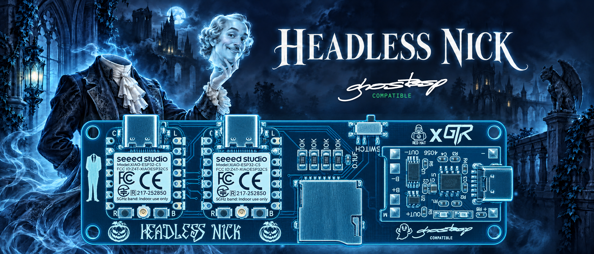
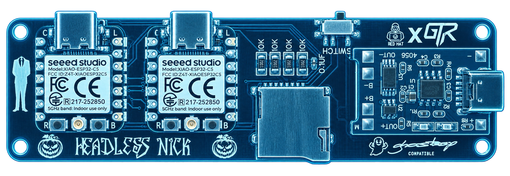
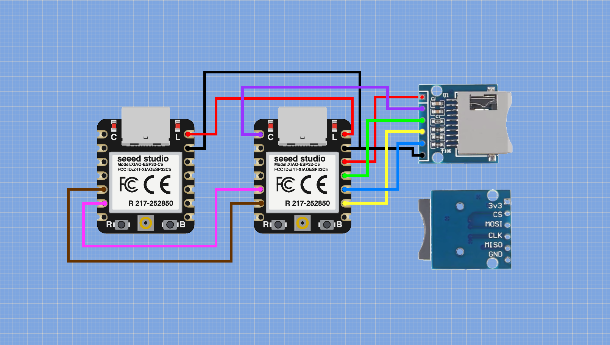

  

   
   

  

    
    
    
  

  

    
    
    
    
    
  

  

    
    
  

&nbsp;

## :star2: About the Project

**Headless Nick** is a custom hardware build made to work with **GhostESP firmware** and its **GhostLink** feature. It brings together two Seeed Studio XIAO ESP32-C5 boards, a MicroSD card tray, and a rechargeable 18650 battery on a custom PCB.

The MicroSD tray connects to the Main XIAO. The two XIAO boards communicate over crossed GPIO connections, while a TP4056 charging module is wired to the battery pads on both boards. A physical switch lets the device be powered off while the battery charges.

> ⚠️ Headless Nick is an independent hardware project. It is designed for use with GhostESP, but it is **not made by or affiliated with the GhostESP project**.

&nbsp;

## ✨ Highlights

- ⚙ **Dual XIAO ESP32-C5 boards** – two boards connected for GhostLink use
- 🔗 **Cross-connected GPIO** – Main GPIO 23 connects to second GPIO 24, and Main GPIO 24 connects to second GPIO 23
- 💾 **MicroSD card tray** – wired to the Main XIAO only
- 🔋 **18650 battery power** – rechargeable battery-based build
- 🔌 **TP4056 charging** – charger connected to the battery pads on both XIAO boards
- 🎚 **Power switch** – switch the device off while charging
- 🧩 **Custom PCB** – combines the boards, card tray, charging module, and power connections
- 👻 **GhostESP compatible** – configure GhostLink TX to 23 and RX to 24 after flashing both boards

&nbsp;

## 🔌 Hardware Overview

### Core

- **Main board:** Seeed Studio XIAO ESP32-C5
- **Second board:** Seeed Studio XIAO ESP32-C5
- **Storage:** MicroSD card tray connected to the Main XIAO
- **Inter-board link:** GPIO 23 and GPIO 24 cross-connected between the boards

### Power

- **Battery:** 18650 rechargeable cell
- **Charger:** TP4056
- **Charging connection:** TP4056 wired to the battery pads on both XIAO ESP32-C5 boards
- **Power control:** physical switch for turning the device off while charging

&nbsp;

## 🧷 Wiring

### MicroSD card tray → Main XIAO ESP32-C5

The MicroSD tray is connected to the **Main XIAO only**. It is not connected to the second XIAO.

| MicroSD card tray | Main XIAO ESP32-C5 |
|-------------------|--------------------|
| CS                | D0                 |
| CLK               | D8                 |
| MOSI              | D10                |
| MISO              | D9                 |
| VCC               | 3V3                |
| GND               | GND                |

### Main XIAO ESP32-C5 ↔ Second XIAO ESP32-C5

| Main XIAO ESP32-C5 | Second XIAO ESP32-C5 |
|--------------------|----------------------|
| GPIO 23 (D4)       | GPIO 24 (D5)         |
| GPIO 24 (D5)       | GPIO 23 (D4)         |

### Battery and charging

The TP4056 is wired to the battery pads on both XIAO ESP32-C5 boards. Check polarity and inspect the wiring before connecting the battery or powering the device.

## 🧰 GhostESP / GhostLink Setup

1. Flash GhostESP firmware to **both** XIAO ESP32-C5 boards.
2. Configure GhostLink with **TX = 23** and **RX = 24**.
3. Keep the MicroSD card tray connected to the Main XIAO only.

The GhostLink TX/RX settings use GPIO numbers. The physical board-to-board wiring is crossed: Main GPIO 23 goes to second GPIO 24, and Main GPIO 24 goes to second GPIO 23.

&nbsp;

## 🤓 DIY

You can DIY Headless Nick by following this schematic:

&nbsp;

## 🙌 Shoutout / Acknowledgments

**Big** shoutout to **REDHAT** (Surya Rapeti) for re-sizing the PCB (made it smaller), adding resistors and the capacitor necessary for the MicroSD card tray to work right and troubleshooting the PCB design software that was used to create Headless Nick.

**Big** shoutout to **DUGGIE TECH** for initiating and mentoring me through the process of designing the 3D printed case for Headless Nick.

**HUGE** shoutout to the [**GhostESP: Revival**](https://github.com/GhostESP-Revival/GhostESP) project for being the spirit that I designed Headless Nick to possess 👻

## :warning: License

Distributed under the MIT License. See [LICENSE](LICENSE) for more information.

## :handshake: Contact

Find me on [Instagram](https://www.instagram.com/cyb3rb3ast), [TikTok](https://www.tiktok.com/@gh0st3chr3pair), [YouTube](https://youtube.com/@GhosTechRepair) and [Discord](https://discord.gg/apukq2VZxd).
